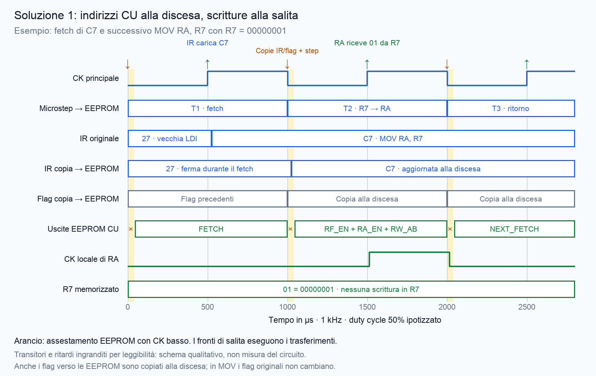

# Transitori delle EEPROM CU: soluzioni documentate

Ricerca del 6 ottobre 2026. La CPU usa registri HC574 e clock locali ottenuti
con porte AND. R7 contiene correttamente 1 prima del fetch, ma può apparire
sovrascritto con C7 dopo il fronte; il puntale sul suo CK modifica il comportamento.
MDR presenta anomalie saltuarie. Sono osservazioni dell'utente, non misure dei fronti.

## Casi di altri costruttori

- [Tom Nisbet, NQSAP-PCB: EEPROM Glitch](https://tomnisbet.github.io/nqsap-pcb/docs/eeprom-glitch/)
  descrive esattamente il rischio delle AND fra CK alto e segnali EEPROM:
  transitori dopo il caricamento di IR possono generare clock locali involontari.
  Il progetto aggiunge una copia di IR aggiornata al fronte di discesa,
  insieme al microstep; i flag non indirizzano le ROM perché i salti sono
  risolti con logica esterna. Quest'ultimo dettaglio è diverso dalla nostra CPU.
- [Eight Bit Computer: Control Unit](https://eight-bit-computer.readthedocs.io/en/master/modules/control_unit.html)
  usa registri copia per IR e flag, aggiornati dal clock di controllo,
  separato dal clock dei dati. Elenca HCT377 per IR e HCT173 per flag.
- [wmvanvliet: miglioramento 2](https://hackmd.io/@wmvanvliet/ryV-N4bI5)
  propone un registro intermedio fra IR/flag e indirizzi EEPROM,
  comandato dal clock invertito. Il testo chiama impropriamente alcuni pin
  del 273 "output enable" e "input enable": non copiarne le indicazioni
  di cablaggio senza il datasheet; il 273 è un registro a fronte con clear.
- [Timbslr: Controller](https://timbslr.github.io/8-Bit-Breadboard-Computer/modules/controller)
  descrive filtri RC sulle linee sensibili agli impulsi e microstep sul
  fronte di discesa. Un filtro analogico introduce ritardo e deve essere
  dimensionato per il circuito reale, non copiato come rimedio universale.

## Applicazione alla nostra CPU — proposta, non ancora realizzata

La strada da approfondire è stabilizzare gli ingressi delle EEPROM durante
la fase alta: microstep sul fronte di discesa e copie di IR/flag aggiornate
sullo stesso fronte. La salita successiva esegue i trasferimenti.
Non basta invertire soltanto il clock del contatore: IR e flag sono anch'essi
indirizzi delle EEPROM. I cinque bit IR[7:3] più quattro flag richiedono nove
bit di copia; copiare l'intero IR e i quattro flag richiede dodici bit,
sempre realizzabili con due registri da otto bit, se adatti per livelli e tempi.
La copia dell'intero IR può mantenere coordinati anche selettore Rn e ALU,
ma la distribuzione delle linee va progettata prima del cablaggio.

Verificare inoltre il ritorno NEXT_FETCH tramite /LOAD sincrono del 74161,
l'arresto HLT (nella scheda attuale taglia il clock), il reset, BOOT/RUN,
la durata della fase bassa, setup/hold e gli enable della RAM. L'inversione
può cambiare anche il modo di contare gli impulsi manuali della guida.
Questa proposta non è uno schema verificato né autorizza a spostare fili
prima di completare il progetto dei tempi.

Il piccolo filtro sul CK o su R_W suggerito nella conversazione resta una
prova diagnostica: non garantisce l'eliminazione dei transitori su altre linee.
La precedente proposta locale con HCT573 e LE=NOT CK richiede la verifica
esplicita della chiusura del latch rispetto ai cambiamenti degli indirizzi.

## Diagramma temporale della proposta

[Versione PDF](images/cu-timing-mirrored-inputs.pdf).
Esempio dei punti 9–11 di step_check: T1 carica C7 nell'IR originale alla
salita; la copia IR indirizzante le EEPROM cambia solo alla discesa seguente,
insieme all'ingresso in T2. La salita successiva trasferisce R7=01 in RA.
I flag originali di MOV non cambiano; il circuito copia comunque i flag
alla discesa. Per ADD i nuovi flag catturati alla salita raggiungerebbero
le EEPROM soltanto alla discesa seguente.
Il diagramma assume duty cycle 50%, mostra ritardi ingranditi e non verifica
skew dei clock, setup/hold, reset o circuito HLT. Il fetch comune deve restare
identico per tutti i gruppi IR e tutte le pagine flag, come nei binari attuali.
